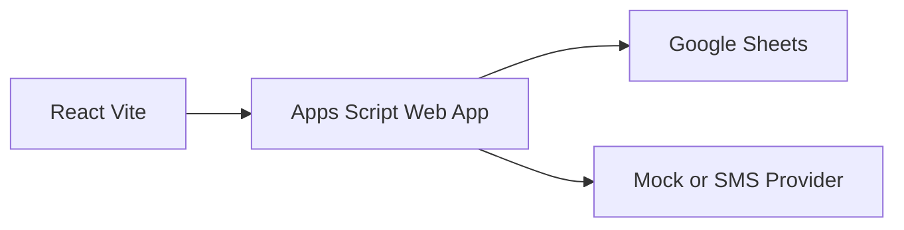
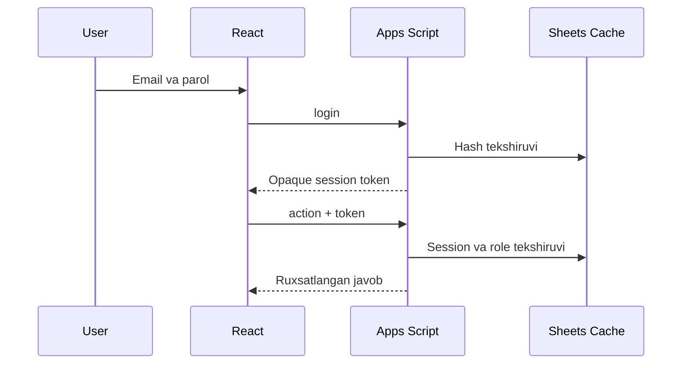
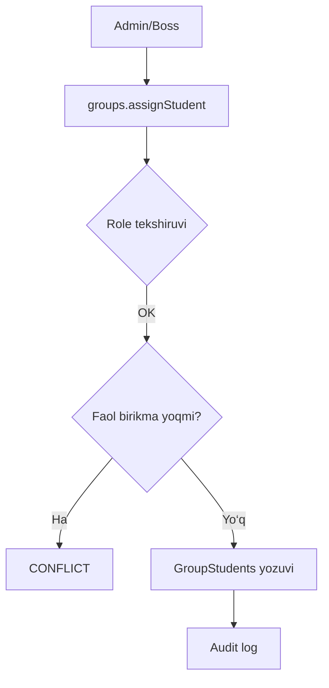
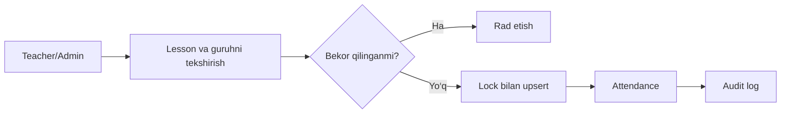
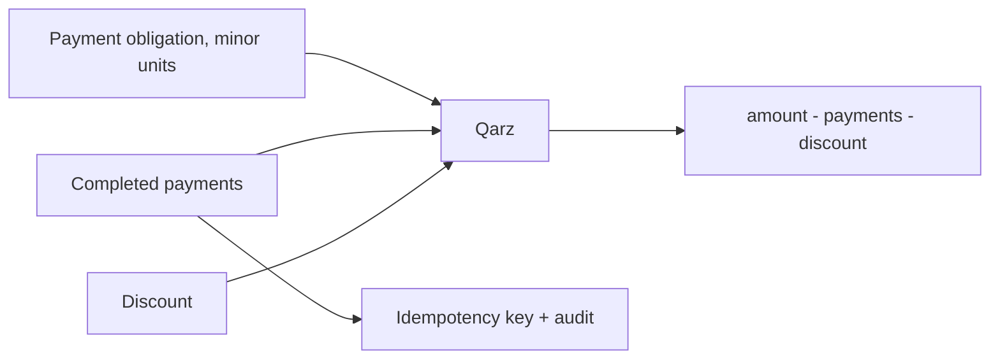
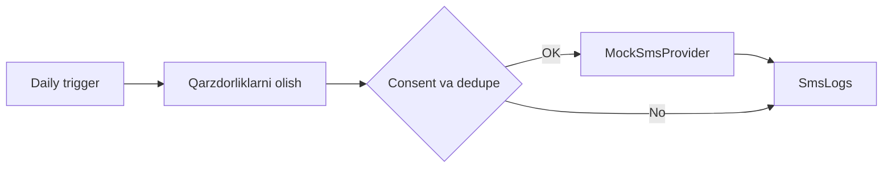

# Avitseniya Academy CRM

React/Vite frontend va Google Apps Script + Google Sheets server tomoni asosidagi EDU CRM.

## Tezkor ishga tushirish

```bash
npm install
copy .env.example .env
npm run dev
```

`.env` ga Apps Script Web App URL kiriting. Offline interfeys ko‘rish uchun `VITE_DEMO_MODE=true` qiling; demo loginlar `boss@demo.uz`, `admin@demo.uz` yoki `teacher@demo.uz`, parol `demo123`. Demo rejimi ma’lumotni saqlamaydi va production uchun mo‘ljallanmagan.

Apps Script deploy va xavfsizlik tartibi [apps-script/README.md](apps-script/README.md) da.

## Arxitektura



## Login va ruxsat



## O‘quvchini guruhga biriktirish



## Davomat



## To‘lov va qarzdorlik



## SMS xabarnoma



## Tekshiruvlar

Frontend build: `npm run build`. Apps Scriptda login, role, CRUD, duplicate attendance, qisman/void payment va mock SMS oqimlarini yuqoridagi actionlar bilan tekshiring. Hech qanday secret repositoryga kiritilmagan.
